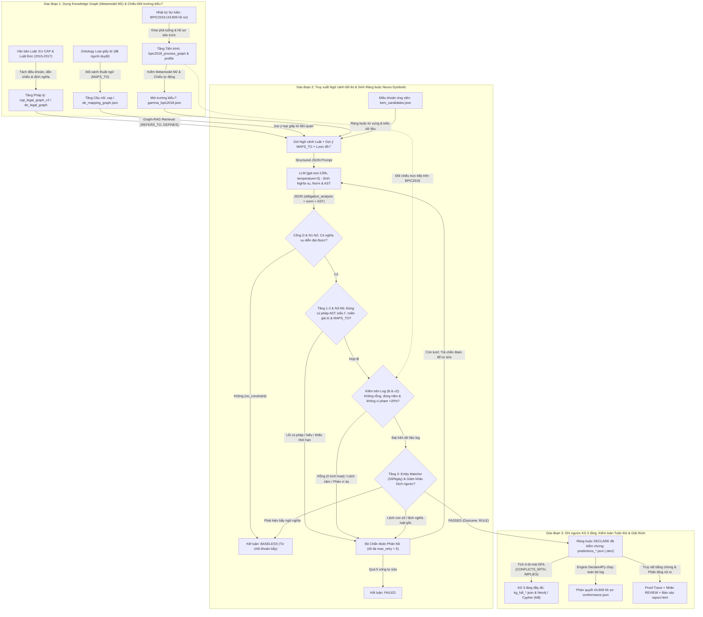

# NSAI + Graph-RAG: hình thức hoá luật thành ràng buộc DECLARE kiểm được trên nhật ký quy trình

Hệ thống Neuro-Symbolic kết hợp **Knowledge Graph (KG) làm mô hình miền thay UML** (Model-Driven Engineering) với LLM:
văn bản luật và nhật ký sự kiện được đưa vào một KG có metamodel đóng; LLM chỉ được sinh ràng buộc DECLARE trong khuôn
mà KG quy định; mỗi ràng buộc phải qua chuỗi kiểm ký hiệu (cú pháp, kiểu, log, dịch ngược) trước khi được ghi trở lại
KG cùng bằng chứng.

**Bộ dữ liệu chính:** nhật ký BPIC2018 (chi trả trực tiếp cho nông dân Đức, 43 809 hồ sơ, 2,5 triệu sự kiện) +
4 Quy định CAP của EU (1306/2013, 1307/2013, 640/2014, 809/2014) + tập Đức (InVeKoSV, DirektZahlDurchfV) theo phiên
bản từng năm. **Model:** `gpt-oss-120b` (Cerebras / Groq). Bộ cũ BPIC2017 + Directive 2008/48/EC: đã gỡ (2026-11-21) — mã còn trong git (commit `57757a4`),
dữ liệu đã chuyển ra kho lưu `C:\Users\hayab\nsai_archive_bpic2017` (mở lại: `git checkout 57757a4 -- scripts src tests`, chép kho lưu về đúng chỗ, rồi
đặt `NSAI_ENABLE_BPIC2017=1`).

## Tài liệu

| Tài liệu | Nội dung |
|---|---|
| [docs/KIEN_TRUC.md](docs/KIEN_TRUC.md) | **Kiến trúc**: 3 mức MDE, 5 tầng KG, 5 giai đoạn, thứ tự kiểm, cấu hình, trạng thái module |
| [docs/HUONG_DAN_THUC_NGHIEM.md](docs/HUONG_DAN_THUC_NGHIEM.md) | **Chạy thực nghiệm** từng bước (cài đặt, sinh, chấm, phân tích, xử lý sự cố) |
| [docs/V2_DANG_KY_TRUOC.md](docs/V2_DANG_KY_TRUOC.md) | **Đăng ký trước** quy tắc đánh giá, các bổ sung B1–B7 và mọi thay đổi |
| [docs/HUONG_DAN_GAN_NHAN_CAP.md](docs/HUONG_DAN_GAN_NHAN_CAP.md), [docs/DE_GAN_NHAN_BO_SUNG.md](docs/DE_GAN_NHAN_BO_SUNG.md) | Gán nhãn gold (CAP, tập Đức) |
| [docs/CONG_TRINH_LIEN_QUAN.md](docs/CONG_TRINH_LIEN_QUAN.md) | Công trình liên quan (đọc toàn văn) |
| [docs/CAP_HIEU_LUC_THOI_GIAN.md](docs/CAP_HIEU_LUC_THOI_GIAN.md) | Hiệu lực theo thời gian của văn bản CAP (giới hạn + độ nhạy) |


> **Kiến trúc Hệ thống & Quy trình Thực thi:** Hệ thống hoạt động theo pipeline **Neuro-Symbolic + Graph-RAG lấy Knowledge Graph có Metamodel đóng làm gốc (thay UML trong MDE)** — hợp nhất văn bản pháp luật và nhật ký sự kiện vào KG 5 tầng, khóa không gian sinh của LLM bằng môi trường kiểu `Γ` chiếu tự động từ KG, và kiểm chứng từng ràng buộc DECLARE qua chuỗi cổng ký hiệu (nghĩa vụ, cú pháp/kiểu, đối chiếu log thực tế, dịch ngược) trước khi ghi ngược vào KG kèm vết bằng chứng.




*(Lưu ý: Toàn bộ nhãn có ký tự đặc biệt `()`, `:`, `&`, `>` đều đã được bọc ngoặc kép `"..."` và không dùng thẻ HTML nên sẽ không bị lỗi cú pháp hay cắt chữ trên GitHub Markdown).*


## Cài đặt nhanh

```powershell
python -m venv C:\Users\<bạn>\.venvs\nsai-compliance          # đặt venv NGOÀI OneDrive
C:\Users\<bạn>\.venvs\nsai-compliance\Scripts\Activate.ps1
pip install -r requirements.txt          # phiên bản ghim đúng như các lần chạy đã báo cáo
pip install -r requirements-dev.txt      # pytest, pytest-cov, ruff
copy .env.example .env                    # điền khoá API (CEREBRAS_API_KEY / GROQ_API_KEY) và Neo4j
python -m pytest tests -q                 # kiểm thử (Neo4j không chạy → các test Neo4j tự bỏ qua)
```

## Chạy

```powershell
python scripts/run_pipeline.py pre                                       # cổng kiểm: metamodel, Γ, tầng Cầu nối, dấu dữ liệu
python scripts/run_cap_generation.py --provider cerebras --out-dir results/<thư mục> --config Y   # sinh (gọi API)
python scripts/run_pipeline.py post --pred-dir results/<thư mục> --configs X Y --conformance    # chấm + phân tích + báo cáo HTML
python scripts/run_pipeline.py replay --pred-dir results/<thư mục>        # sau khi sửa code: kết quả cũ có đổi không
```

Kiểm thử thường trực: `pre` có T1 (dữ liệu phái sinh = dựng lại từ nguồn), `post` kết thúc bằng T2 (bất biến trên
mọi đầu ra), `replay` là T3 (phát lại cache LLM bằng code hiện tại, không gọi API).

Cấu hình: X (chỉ khoản luật), **Y** (Graph-RAG, cấu hình chính), các ablation Y-no*, R (RAG BM25 cùng ngân sách),
N (khung chuẩn tắc), Z (v2) — xem `KIEN_TRUC.md` mục 6. Giám khảo Tầng 3 dùng model khác bộ sinh:
thêm `--judge-provider groq` (hoặc `cerebras`) và `--judge-model <tên>`.

## Cấu trúc thư mục

```
src/preprocessing   tách văn bản luật EU / Đức, dẫn chiếu, đọc log
src/kg              metamodel (M2), dựng các tầng KG, tầng Cầu nối, xuất ràng buộc, Neo4j, biên dịch AST → Cypher (M8)
src/mde             schema AST ràng buộc (Tầng 1), Γ chiếu từ KG + môi trường kiểu (Tầng 2)
src/neural          ngữ cảnh Graph-RAG (Y, Z) và BM25 (R)
src/symbolic        engine Declare trên log, kiểm nghĩa vụ (D), khung chuẩn tắc (N1–N5), kiểm tầng Tiến trình (v2),
                    dịch ngược + giám khảo (Tầng 3), kiểm tập ràng buộc (DFA)
src/evaluation      vòng sinh–kiểm với LLM thật, chấm điểm, phễu, proof trace, nhãn REVIEW, dấu dữ liệu + code
scripts/            mọi lệnh chạy (run_pipeline.py là điểm vào)
data/processed      KG, Γ, khoản luật đã tách      data/review   gold, phiếu gán nhãn, ontology đã duyệt
results/            kết quả chạy (không đưa vào git — có cache câu trả lời LLM, giữ bản sao riêng)
```

## Tình trạng (2026-11-20)

Đã có: toàn bộ pipeline 5 giai đoạn, KG 5 tầng tuân thủ metamodel, kiểm trên Neo4j (M8) khớp engine từng hồ sơ,
nhãn REVIEW, khung chuẩn tắc. Kết quả CAP v1.1: hệ thống từ chối đúng phần lớn khoản bẫy nhưng **chưa đúng khoản
positive nào (0/3)** và **thua mức chuẩn "luôn BASELESS"**; tập positive mới (tập Đức) đang gán nhãn. Chi tiết và giới
hạn: `KIEN_TRUC.md`, `V2_DANG_KY_TRUOC.md`.
